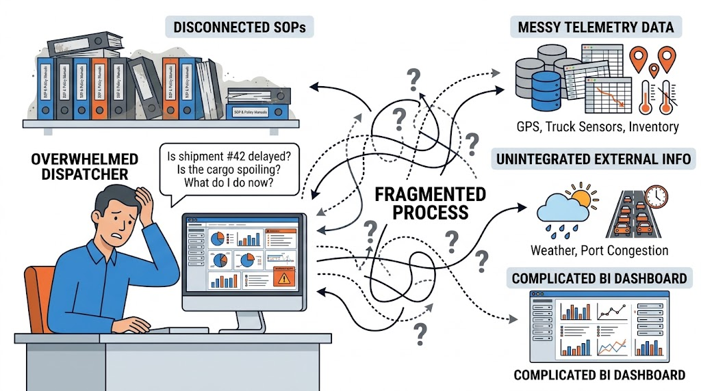
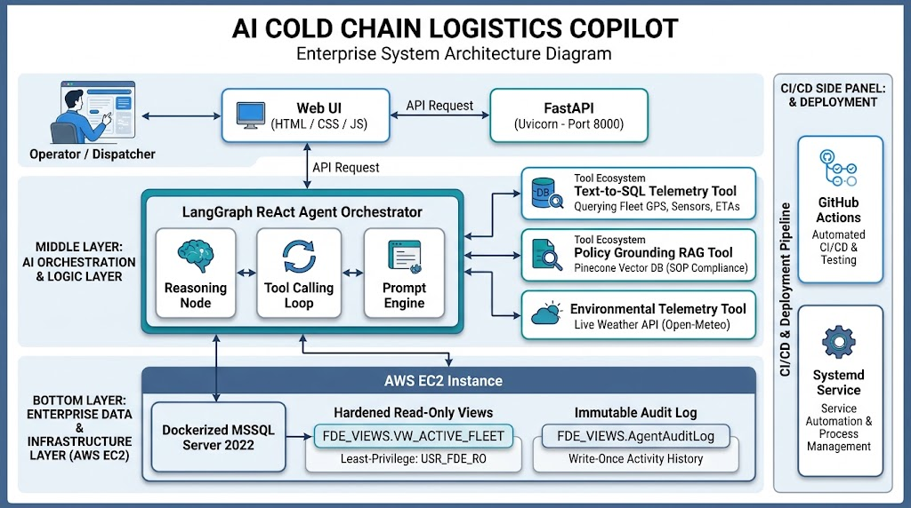
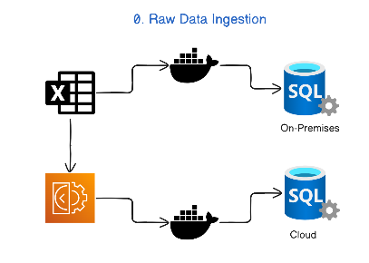
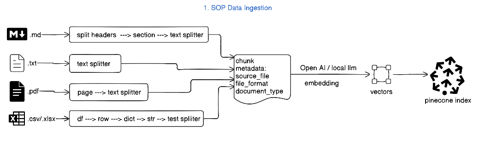
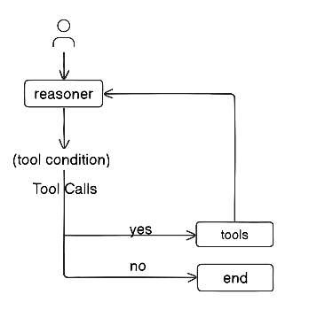

# Logistic Agent

# Business Problem
### In a traditional cold-chain logistics setup, dispatchers and control tower operators manage fleets transporting temperature-sensitive goods (such as fresh perishables and pharmaceuticals) using a fragmented, legacy infrastructure.




1. Dashboard & Metric Overload (Dashboard Fatigue):
- Operators rely on static BI dashboards and legacy MSSQL databases with complex drop-downs, queries, and filters.

- Answering critical questions (e.g., "Which refrigerated trucks in Southern California are at risk of cargo spoilage?") requires tedious manual cross-referencing between GPS locations, IoT temperature readings, traffic data, and delivery ETAs.

2. Disconnected Operational Knowledge (SOPs):

Standard Operating Procedures (incident SOPs, escalation protocols, tier-1 vs. tier-2 rules, emergency cold-storage diversions) reside in unstructured policy documents (Markdown/PDF) disconnected from real-time fleet telemetry.

Operators must manually look up procedures to decide what corrective action to take when a temperature breach or port congestion occurs.

3. Lack of Real-Time Contextual Awareness:

- Internal truck sensors track refrigerated cargo, but the legacy system lacks integration with live external environmental data (e.g., ambient heat spikes, wind speeds, route weather conditions).

4. Security, Governance, and Mutation Risks:

- Enterprise IT requires that any modern querying layer strictly prevents unauthorized database mutations (dropping or corrupting tables) and ensures complete compliance tracking.


# The Proposed Solution



### As an AI Forward Deployed Engineer (FDE) Logic Agent Copilot using a LangGraph ReAct orchestration agent wrapped rich UI/UX framework:

- **Natural Language Querying (Text-to-SQL)**: Operators query fleet telemetry directly in plain English over hardened, read-only SQL views.

- **Policy Grounding (RAG)**: Uses a vector database (Pinecone) to ground recommendations in enterprise incident SOPs with citations.

- **Live Environmental Telemetry**: Integrates an external live weather API (Open-Meteo) to cross-verify cargo anomalies against ambient conditions.

- **Enterprise Governance**: Implements least-privilege database roles and an immutable audit logging table directly in SQL to track every agent action and tool call.


# Phase 0: Data Ingestion



## Source:
### Data: https://www.kaggle.com/datasets/datasetengineer/logistics-and-supply-chain-dataset?resource=download

### Ingesting data:
- Download the dataset from 'data\dynamic_supply_chain_logistics_dataset.csv'
- Create EC2 instance > docker container > mcr.microsoft.com/mssql/server:2022-latest
- Spin up the Legacy MSSQL Server

- Create docker container
```
docker run -e "ACCEPT_EULA=Y" -e "MSSQL_SA_PASSWORD=FDElogistic321!" -p 1433:1433 --name legacy-mssql -d mcr.microsoft.com/mssql/server:2022-latest
```
- Check the image
```
docker ps -a
```

- Run the container in docker.desktop after that run the below script
```
python scripts\ingest_legacy_data.py
```
### Connecting to the data
- Use VS code extention : "SQL Server (mssql) by microsoft
#### Add connection to local
```
Profile Name: supply_chain
Server name*: localhost
Port: 1433
Trust server certificate: turn it ON (Crucial for Docker)
Authentication type*: SQL Login
User name*: SA
Password*: FDElogistic321!
Save Password: Check this box
Database name: Type master (or leave it on "Select a database")
Encrypt: Change this from Mandatory to Optional (or False)
```

#### Add connection to cloud (AWS)

- Create EC2 instance
1. Platform: Ubuntu
2. Instance type: t3.micro
3. Create new key pair
4. Select existing security group ( After creating new security group - Inbound rules -2 for (MSSQL & SSH) and Outbound rules for All traffic )
5. Configure storage - 30 GB
6. File system - None
7. Launch instance


- Connect to a Linux EC2 instance

1. Open the local terminal - cmd
```
ssh -i /path/to/your-key.pem username@your-ec2-public-ip
```
2. Update the system package manager
```
sudo yum update -y 
```
3. Install and start Docker
```
sudo yum install docker -y
```
4. Create docker container
```
docker run -e "ACCEPT_EULA=Y" -e "MSSQL_SA_PASSWORD=FDElogistic321!" -p 1433:1433 --name legacy-mssql -d mcr.microsoft.com/mssql/server:2022-latest
```
5. Check the image
```
docker ps -a
```
6. If docker container stopped
```
sudo docker start legacy-mssql
```
7. Run the script after change the SQL_SERVER_HOST to cloud IP address
```
python scripts\ingest_legacy_data.py
```
```
Profile Name: cloud_supply_chain
Server name*: 15.135.187.245 (Derived the IP from created public IP address from created EC2 instance)
Port: 1433
Trust server certificate: turn it ON (Crucial for Docker)
Authentication type*: SQL Login
User name*: SA
Password*: FDElogistic321!
Save Password: Check this box
Database name: Type master (or leave it on "Select a database")
Encrypt: Change this from Mandatory to Optional (or False)
```

# Phase 1: SOP Ingestion



- Get the pinecone API key
- Run python scripts\ingest_sop_pinecone.py

# Phase 2: Data Security
- Click on file scripts\setup_security_and_view.sql
- Once done, create a new connection now with Agent-Profile (cloud_supply_chain_ro)

```
Profile Name: cloud_supply_chain_ro
Server name*: 15.135.187.245 (Derived the IP from created public IP address from created EC2 instance)
Port: 1433
Trust server certificate: turn it ON (Crucial for Docker)
Authentication type*: SQL Login
User name*: USR_FDE_RO
Password*: FDEAgentPassword2026!
Save Password: Check this box
Database name: Type master (or leave it on "Select a database")
Encrypt: Change this from Mandatory to Optional (or False)
```

- Connect and test below commands
Test 1 - should work
```
SELECT TOP 5 * FROM FDE_VIEWS.VW_ACTIVE_FLEET;
````

Test 2 - should fail
```
SELECT TOP 5 * FROM dbo.supply_chain_hist_raw_data
```
# Phase 3: 



- Testing agent tools
run src\agent_tools.py
- Testing agent
run src\orchestrator.py

- Test case: 1
```
Find any active shipments near Los Angeles (Latitude ~33.8, Longitude ~-118.1). Check the local weather there, and tell me if the current cargo temperature violates the SOP for fresh perishables.
```
- Test case: 2
```
I'm a new dispatcher on the night shift. Can you quickly explain the difference between a Tier 1 and Tier 2 escalation?
```
# Phase 4:
- Create New Query in cloud_supply_chain
- Create the Agent Audit log table
```
CREATE TABLE FDE_VIEWS.AgentAuditLog(
    LogID INT IDENTITY(1,1) PRIMARY KEY,
    Timestamp DATETIME DEFAULT GETDATE(),
    SessionID VARCHAR(50),
    NodeExecuted VARCHAR(50),
    ToolName VARCHAR(50),
    Content NVARCHAR(MAX) -- NVARCHAR to safely handles JSON strings and LLM 
);
```

# Phase 5
- Create UI/UX using static\script.css, static\style.js and templates\index.html files
- Run python app.py

# Phase 6: CI/CD
- Crate a new instance 'supply_chain_server_test' for deployment
- Keep everything as previous including key pair and security group. 
- In the security group Inbound rules add another Security group ID as 'Custom TCP' with port range 8000 and the Source is 0.0.0/0
- Open the terminal with 'supply_chain_server_test' public IP address.
```
sudo apt update && sudo apt install -y python3-pip python3-venv git
cd
git clone https://github.com/Shihamfm/logistic_agent.git
cd logistic_agent
python3 -m venv venv
source venv/bin/activate
pip install -r requirements.txt
```

- insert the .env file ( create the .env file using nano .env and insert all the elements)
```
ls
nano .env
ls
ls -a
```

- make sure if ODBC Driver 17 for SQL Server installed
```
sudo apt update
sudo apt install -y unixodbc unixodbc-dev
curl -fsSL https://packages.microsoft.com/keys/microsoft.asc | sudo gpg --dearmor -o /usr/share/keyrings/microsoft-prod.gpg
curl -fsSL https://packages.microsoft.com/config/ubuntu/$(lsb_release -rs)/prod.list | sudo tee /etc/apt/sources.list.d/mssql-release.list
sudo apt update
sudo ACCEPT_EULA=Y apt install -y msodbcsql17
odbcinst -q -d
```

- Test the script by open the browser as "http://<YOUR_EC2_PUBLIC_IP>:8000"
```
python app.py
```

# Phase 7: Deployment
- Create the deploy.yaml file
- In Github >> Settings >> Environments 
- Create Environment called 'LOGISTIC ENVIRONMENT'
- Added the secrets EC2_HOST, EC2_SSH_KEY & EC2_USER.  

# Phase 8: Create logsitic-agent with EC2 instance
```
[Unit]
Description=Logistics Agent FastAPI Service
After=network.target

[Service]
User=ubuntu
WorkingDirectory=/home/ubuntu/logistic_agent
Environment="PATH=/home/ubuntu/logistic_agent/venv/bin"
ExecStart=/home/ubuntu/logistic_agent/venv/bin/uvicorn app:app --host 0.0.0.0 --port 8000
Restart=always
RestartSec=3

[Install]
WantedBy=multi-user.target
```

# Phase 8: Register and start the service
```
sudo systemctl daemon-reload
sudo systemctl enable logistic-agent
sudo systemctl restart logistic-agent
```